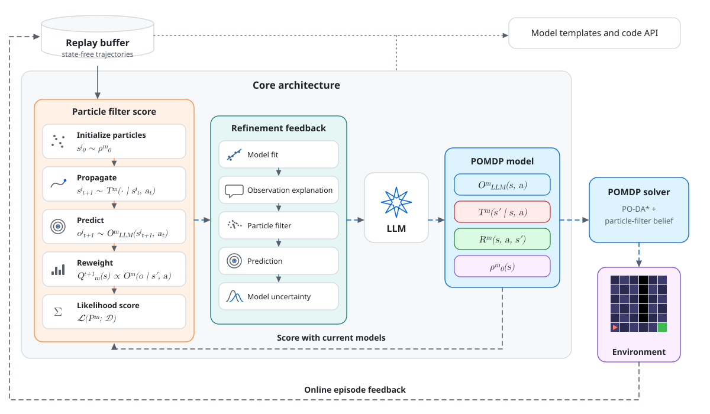
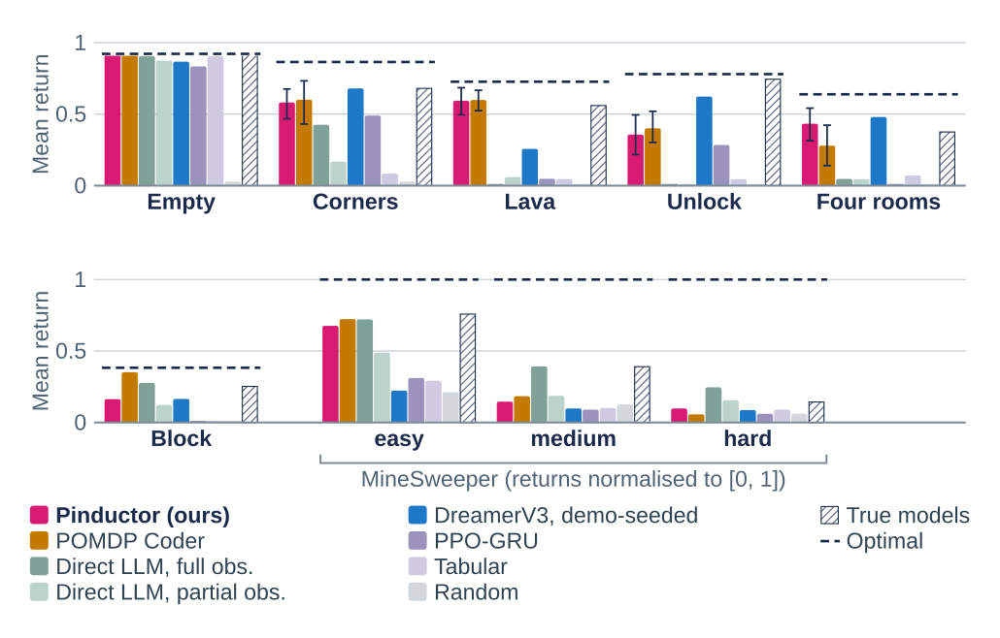

<div align="center">

# Pinductor

**Learning POMDP World Models from Observations with Language-Model Priors**

<a href="https://arxiv.org/abs/2605.13740"></a>
<a href="https://arxiv.org/abs/2605.13740"></a>
<a href="https://mtsfj.github.io/articles/pinductor.html"></a>

<a href="LICENSE"></a>

<picture>
  <source media="(prefers-color-scheme: dark)" srcset="docs/assets/pipeline-dark.svg">
  
</picture>
<sub><i>The Pinductor pipeline, as in the paper.</i></sub>
</div>

---

Pinductor uses a large language model as a prior over executable POMDP
programs, and refines the proposals against a particle-filtered kernel
pseudo-likelihood — without ever seeing a ground-truth hidden state. The
induced model is consumed by a belief-space planner during online
interaction; the agent matches the privileged-state LLM baseline of
Curtis et al. (2025) on MiniGrid while operating strictly from
observations, actions, and rewards. The release also covers the two
further suites of the paper, a partially observable Blocks World and
PopGym MineSweeper, and the learned baselines it compares against.

<p align="center"></p>
<p align="center"><sub><i>Main task performance (paper, redrawn for the NeurIPS poster): mean return, 95% intervals for Pinductor and POMDP Coder, optimal reference dashed. Pinductor is comparable to POMDP Coder without ever accessing hidden states.</i></sub></p>

### The loop in the code

| Step | Paper | Code |
|:--|:--|:--|
| Pick a parent model to refine (UCB1) | Eq. 16 | [`rex_helpers.py`](uncertain_worms/policies/rex_helpers.py) · `ucb1_select` |
| The LLM proposes new POMDP components | Alg. 1 | [`base_policy.py`](uncertain_worms/policies/base_policy.py) · `requery_joint` |
| Score each candidate against observations with a particle filter | Eqs. 5, 7 | [`get_score_metrics.py`](particle_filtering/get_score_metrics.py) · `LikelihoodEvaluator` |
| Measure committee disagreement (vote entropy) | Eq. 8 | [`model_disagreement.py`](particle_filtering/model_disagreement.py) |
| Select the final model (near-best set, softmax) | Eqs. 17–18 | [`partially_obs_planning_agent.py`](uncertain_worms/policies/partially_obs_planning_agent.py) · `joint_update_models_rex` |
| Plan online over the particle belief | §4.5 | [`PO_DAStar.py`](uncertain_worms/planners/PO_DAStar.py) |

The full paper-to-code map, with every hyperparameter, is in [`docs/ARCHITECTURE.md`](docs/ARCHITECTURE.md).

📘 **Start here**: [`docs/QUICKSTART.md`](docs/QUICKSTART.md) for the
five-minute install + smoke walkthrough.
🏗️ **Architecture & paper-to-code map**: [`docs/ARCHITECTURE.md`](docs/ARCHITECTURE.md).

---

## Table of contents

1. [What's in this bundle](#1-whats-in-this-bundle)
2. [Installation](#2-installation)
3. [API keys](#3-api-keys)
4. [Smoke tests (do this first)](#4-smoke-tests-do-this-first)
5. [Reproducing the paper](#5-reproducing-the-paper)
6. [Datasets](#6-datasets)
7. [How the dual-cwd model works](#7-how-the-dual-cwd-model-works)
8. [Troubleshooting](#8-troubleshooting)
9. [Repository layout](#9-repository-layout)
10. [How to extend](#10-how-to-extend)
11. [License and citation](#11-license-and-citation)

---

## 1. What's in this bundle

- The **Pinductor** pipeline (`uncertain_worms/`, `particle_filtering/`)
- The reused **POMDP Coder baseline** of Curtis et al. (2025) under
  `curtis_baseline/`, with the Spot/bosdyn dependencies stripped from its
  `pyproject.toml`. It mirrors the three environment families, since the
  tabular and random conditions run from there (§7).
- The paper experiment driver and Hydra configs (`scripts/paper/`)
- Pre-collected offline demonstration datasets (~3.7 MB) under
  `uncertain_worms/environments/minigrid/trajectory_data/*_paper_N*.pkl`
- Source `*_pure_mixed.pkl` buffers used by `regenerate_datasets.py`
- The **Blocks World** environment (`uncertain_worms/environments/blocksworld/`)
  with its own demonstration sets. Blocks is the non-navigation domain: a
  gripper rearranges stacks of numbered blocks and sees only the column it
  stands on, so nothing about it is a grid.
- The **PopGym MineSweeper** environment (`uncertain_worms/environments/popgym/`)
  at three difficulties, with random-policy demonstrations. The wrapper takes
  any PopGym environment through its `env_id`, but only MineSweeper is used in
  the paper and only its demonstrations ship here.

- The learned baselines under `baselines/`: both DreamerV3 families and the
  OpenVLA-7B arm
- Every number the paper reports, one CSV per table, under `results/`

A clean checkout fits under 30 MB on disk.

---

## 2. Installation

Tested on **Ubuntu 24.04**, **Python 3.11** and **Python 3.12** (a fresh
`pip install -e .` was verified end-to-end on both), single CPU
workstation, **no GPU**.

```bash
# 1. Create and activate a fresh environment
conda create -n pinductor python=3.11 -y
conda activate pinductor

# 2. Install Pinductor (this also pulls every dep needed by curtis_baseline/)
pip install -e .
```

This single install is enough for both Pinductor and the POMDP Coder
baseline. Both subtrees define a package named `uncertain_worms`; the
runner sets the working directory of each subprocess to either the
top-level repository or `curtis_baseline/`, so Python's normal CWD-on-path
behaviour selects the right implementation. `curtis_baseline/pyproject.toml`
is provided for documentation and standalone inspection — installing it is
**not** required.

The `pip install` step pulls `pymdptoolbox` from a public GitHub fork; if
your machine has no internet access at install time, vendor it manually
into your environment first.

Optional extras (not needed to reproduce the paper, but used for prettier
plots and a faster particle-filter kernel):

```bash
pip install -e '.[fast,plots]'   # numba JIT + tueplots paper-style bundle
```

---

## 3. API keys

Pinductor and the POMDP Coder baseline call LLMs through OpenRouter. Copy
`.env.example` to `.env` at the repository root and set your key:

```bash
cp .env.example .env
$EDITOR .env   # set OPEN_ROUTER_KEY=...
```

The LLM-free baselines (`tabular`, `random`, `curtis_hardcoded`) do **not**
require any API key — you can ignore this step if you only want to run
them.

If both keys (primary + backup) start returning HTTP 402/429, the runner
will mark the affected atoms as `rate_limited` in the SQLite registry; you
can resume them later with the `resume` subcommand (see §5).

---

## 4. Smoke tests (do this first)

Three tiers, ordered from fastest to slowest. Run them in order; if tier
*N* fails, **do not** spend money on tier *N+1*.

### 4.1. Imports — under one second, no API key

```bash
python -c "import uncertain_worms; print('uncertain_worms OK')"
```

Expected: `uncertain_worms OK`. A failure here means `pip install -e .`
did not complete cleanly.

### 4.2. Unit tests — under thirty seconds, no API key

```bash
python scripts/paper/tests/run_all.py
```

Expected: `OVERALL: PASS (7 suites)`. The test runner spawns one
subprocess per suite; individual suites can also be run directly with
`python scripts/paper/tests/test_<name>.py`.

### 4.3. Tabular run — about one minute, no API key

```bash
python scripts/paper/paper_runner.py run E1 \
    --envs lava --conditions tabular --seeds 0
```

Expected last line: `[done] {'done': 3}`. Outputs land under
`outputs/paper_runs/runs/E1__lava__tabular__s0__<hash>/`, including
`result.json` (with a numeric `avg_reward` field and the per-episode `rewards`), `stdout.log`,
`stderr.log`, and a Hydra `metadata.json`.

### 4.4. Blocks run — about six minutes, no API key

```bash
python main.py --config-dir=scripts/paper/configs/ours_hardcoded \
    --config-name=blocks num_episodes=1 max_steps=20 \
    agent.planner.max_expansions=500
```

Expected: the episode runs to completion, the log ends on
`Average Episode Reward:` and on `[TOKENS] 0 LLM calls`. This exercises the
non-grid environment, the particle filter and the belief-space planner
together, on ground-truth models, so a failure here is a pipeline problem
rather than an induction one.

The two overrides are what keep it to six minutes; measured, on one core of a
Ryzen 7 7800X3D. Blocks is slow to plan — a hundred particles over a
423,360-transition space — so the configuration's own budget of 20,000 node
expansions costs about a minute per step. Twenty steps at 500 expansions will
not solve a `rand6` instance and is not meant to: the paper's protocol is the
120 steps the config declares, over 10 seeds of 3 episodes, and it takes hours.

### 4.5. End-to-end LLM smoke — five to ten minutes per atom, requires `OPEN_ROUTER_KEY`

```bash
# Pinductor (ours) — joint TROI proposal
python scripts/paper/paper_runner.py run E1 \
    --envs lava --conditions ours --seeds 0

# POMDP Coder baseline — per-component proposals
python scripts/paper/paper_runner.py run E1 \
    --envs lava --conditions curtis_their --seeds 0
```

Each atom does three episodes (configurable via the YAML); the first one
takes longer because the LLM proposes the initial model. You can interrupt
with `Ctrl-C` once you see at least one `episode_<k>_iter_<j>_step_*` file
in the run directory — the pipeline is then confirmed to be wired
end-to-end (dataset → particle filter → LLM proposal → planner).

---

## 5. Reproducing the paper

`scripts/paper/paper_runner.py` is the canonical driver. It enumerates the
(env, condition, seed, episode) atoms for each experiment, deduplicates
against a SQLite registry (`outputs/paper_runs/registry.db`), and launches
one Hydra subprocess per atom. Outputs land under
`outputs/paper_runs/runs/<exp>__<env>__<cond>__s<seed>__<hp_hash>/`.

Three subcommands are exposed:

| Subcommand | Use it to |
| --- | --- |
| `run <exp>` | Launch atoms for `<exp>` (skipping any already `done` per the registry) |
| `status [--exp <exp>]` | Count atoms by status (`pending`, `done`, `failed`, `rate_limited`, `skipped_dedup`) |
| `resume [<exp>]` | Re-launch only the atoms that are `pending`, `failed`, or `rate_limited` |

### 5.1. Paper experiment table

| Paper experiment | Command | Default budget |
| --- | --- | --- |
| **E1** main reward | `python scripts/paper/paper_runner.py run E1` | 4 envs × 5 conds × 10 seeds × 3 ep |
| **E2 offline** sample efficiency | `python scripts/paper/paper_runner.py run E2_offline` | 2 envs × 3 conds × N ∈ {2,4,6,8,10,12} × 10 seeds |
| **E2 online** learning curves | `python scripts/paper/paper_runner.py run E2_online` | 2 envs × {ours, curtis_their, tabular} × 10 seeds × K=10 ep |
| **E2b** stochastic robustness | `python scripts/paper/paper_runner.py run E2b` | 2 stochastic envs × {ours, curtis_their, random, tabular} × 10 seeds × 3 ep |
| **E4** LLM ablation | `python scripts/paper/paper_runner.py run E4` | 2 envs × {Qwen3-14B, Claude Opus 4.7} × 10 seeds × 3 ep |

Blocks and MineSweeper are not part of those five; they are run from their own
configs (§5.3), Blocks at 120 steps over 10 seeds of 3 episodes and MineSweeper
over 3 episodes at 14, 30 and 54 steps (one per safe cell on Easy, Medium and
Hard).

The three MineSweeper difficulties share the Easy hyperparameters; only the
board, action count, step cap and description change with the difficulty.

`Empty`, `blocks` and the three `minesweeper_*` are not reachable through the runner:
its environment table covers the seven MiniGrid names the figures use. Launch
them directly instead, as in §4.4 and §5.3.

`Empty` is also configured for four conditions rather than eight. Its
demonstrations exist only in the schema of the top-level package: the baseline
copy under `curtis_baseline/` declares an extra observation field, and loading
them there raises. Every condition that reads demonstrations from that
directory — `tabular`, `curtis_their` and both Direct LLM variants — therefore
has no Empty configuration, rather than one that fails on contact.

### 5.2. Useful flags

```bash
# Plan only — print the atoms that would be launched, and their hp_hash.
python scripts/paper/paper_runner.py run E1 --dry-run

# Restrict the sweep (these flags accept comma-separated lists).
python scripts/paper/paper_runner.py run E1 \
    --envs lava,unlock --conditions ours,tabular --seeds 0,1

# Time-bounded run — stops launching new atoms after the given wall budget.
python scripts/paper/paper_runner.py run E1 --max-hours 4

# Parallel atoms (one Hydra subprocess each — watch RAM and rate limits).
python scripts/paper/paper_runner.py run E1 --workers 2

# Re-attempt only the unfinished atoms.
python scripts/paper/paper_runner.py status
python scripts/paper/paper_runner.py resume E1
```

### 5.3. Single-atom manual launch

The runner takes care of switching to the correct working directory (the
`ours*` conditions run from the repository root, while `curtis_*`,
`random`, `tabular` and both Direct LLM variants run from `curtis_baseline/`), so you almost never
need to invoke `main.py` directly. If you want to:

```bash
# Prefer the runner:
python scripts/paper/paper_runner.py run E1 \
    --envs lava --conditions ours --seeds 0

# Direct invocation (advanced — see §7 for the cwd model):
python main.py --config-path=$(pwd)/scripts/paper/configs/ours \
    --config-name=lava seed=0 num_episodes=1
```

Available **conditions** are the subdirectories of `scripts/paper/configs/`,
and the environments of each are the file names inside it. They do not all
carry the same set, so read the directory rather than assuming:

| Condition | Environments |
|---|---|
| `ours`, `ours_hardcoded`, `random` | all 12 |
| `curtis_their`, `tabular` | 11 — all but `empty` |
| `curtis_hardcoded` | 8 — MiniGrid only |
| `direct_llm_po`, `direct_llm_fo` | 8 — `blocks`, `corners`, `four_rooms`, `lava`, `unlock` and the three `minesweeper_*` |

The twelve are `corners`, `empty`, `four_rooms`, `four_rooms_stoch`, `lava`,
`lava_stoch`, `unlock`, `unlock_stoch`, `blocks` and the three
`minesweeper_*`.

### 5.4. Tabular baseline

Counts transitions, rewards and observations from the same offline
demonstrations the LLM methods read, then plans on the resulting tables.
No API key.

```bash
python scripts/paper/paper_runner.py run E1 \
    --envs lava --conditions tabular --seeds 0
```

It is the reference for how far counting alone gets you. The example above
runs Lava, whose demonstrations hold 168 transitions; Blocks is the extreme
case, with 780 against 105,840 reachable states. Either way most cells are
never visited, which is the point of the comparison rather than a shortcoming
of the implementation.

### 5.5. Recurrent PPO

The memory-based RL baseline. One entry point for all three suites, no RL
library: a GRU actor-critic and a PPO loop, in
`uncertain_worms/policies/recurrent_ppo.py`.

```bash
python scripts/train_recurrent_ppo.py --env lava --episodes 1000 --seed 0
```

Environments: `blocks`, `empty`, `lava`, `corners`, `four_rooms`, `unlock`,
`minesweeper_easy`. Add `--smoke` for a 32-episode run that only checks the
loop turns over. Give it the full thousand episodes before reading anything
into the numbers: MiniGrid has six actions, two of which are inert in several
environments, so on Empty-5x5 the return sits at zero for six hundred episodes
before climbing to 0.27 on held-out instances by episode 1200.

### 5.6. DreamerV3

Vendored under `baselines/`, both families the paper reports: the JAX one
online from scratch, and the PyTorch one with its replay pre-loaded from our
demonstrations. Upstream code is unmodified apart from a 94-line patch kept
next to it; the environment bridges are ours.

The two arms need incompatible versions of `gym`, so they get one extra each
and want separate environments — installing both into the same one breaks the
JAX arm.

```bash
# demonstration-seeded (PyTorch): replay pre-loaded from our demonstrations
pip install -e '.[dreamer-torch]'
cd baselines/dreamerv3-torch && bash campaign_offline.sh   # needs a CUDA device

# online from scratch (JAX): no demonstrations
pip install -e '.[dreamer-jax]'
cd baselines/dreamerv3 && UW_ENV_NAME=MyMiniGrid-LavaWall-v0 UW_MAX_STEPS=40 \
    python dreamerv3/main.py --configs size1m \
    --task gym_uw_envs:UWMiniGrid-v0 --run.steps 1000000 --jax.platform cpu
```

The `uw_envs:` prefix in the task is what makes `gym.make` import the bridge and
run its registration; gym 0.22 reads that prefix as a namespace instead and
fails, which is why the JAX extra pins 0.25.

The PyTorch arm is the one part of this repository that needs a GPU. Its
upstream wires `device='cuda:0'` into `networks.py` rather than threading the
configured device through, so a device passed on the command line does not
reach it; we left that code as published rather than patching a vendored file.
Any accelerator that PyTorch exposes as `cuda` works, including ROCm — verified
on a Radeon RX 7900 XTX, where the world model builds and trains at about 2.2
GiB. The JAX arm runs on CPU with `--jax.platform cpu`, which is what the
paper's online runs used.

One trap if you invoke `dreamer.py` directly rather than through the campaign
script: it counts the steps already present in `train_eps/` — the seeded
demonstrations — against `--steps`, and its loop runs while the step count is
below `steps + eval_every`. With the default `eval_every` of 1e4 that slack
hides the problem, but shorten both for a quick probe and the run exits
cleanly, status zero and no warning, having trained on nothing. Keep `--steps`
above the seeded step count.

See `baselines/README.md` for what is vendored, from which commit, and under
which licence. Both upstreams are MIT.

### 5.7. Single-shot induction

One induction call, no refinement and no online phase: the model the LLM
writes on first sight of the demonstrations, used as is. It separates what
the prior supplies from what the loop adds, and it is an override of the
`ours` condition rather than a condition of its own.

```bash
python main.py --config-path=$(pwd)/scripts/paper/configs/ours \
    --config-name=lava seed=0 \
    agent.num_model_attempts=1 agent.use_online=false
```

Both overrides matter. Dropping `use_online=false` alone would still let
the pipeline repair the first model from collected experience, which is
exactly the contribution being isolated.

---

### 5.8. Optimal reference

The upper bound the partially observable methods are measured against: an
agent that sees the hidden state and plays exactly. It uses none of this
pipeline.

```bash
python scripts/paper/optimal_baseline.py --part all   # about ten minutes
python uncertain_worms/planners/greedy_full_obs_planner.py
```

The first enumerates optimal plans and reports the discounted return over the
same 10 seeds x 3 episodes every method is evaluated on; it reproduces the five
published MiniGrid values. The second is the MineSweeper policy, and checks
itself against the closed form rather than against a remembered number: a full
clear pays `max_episode_length * (1 / max_episode_length)`, exactly 1.0 at
every difficulty.

It covers the three families. MiniGrid and Blocks are searched breadth-first
over the fully observed state and reported discounted at 0.98; MineSweeper is
reported undiscounted, which is how the paper reports it, since a full clear
pays exactly 1.0 by construction. Reproduced: 0.9224 on Empty against 0.922
published, 0.8648 against 0.865, 0.7268 against 0.727, 0.7795 against 0.780,
0.6391 against 0.639, and 0.3829 on Blocks against 0.383.

Blocks needs a depth bound of 120 rather than something tighter: two of its
thirty instances need 62 moves, and cutting the search shorter scores them zero
and moves the mean by 0.02.

### 5.9. Direct LLM

The ablation that separates the pipeline from the language model: the model is
asked for the next action directly, with no induced model, no particle filter
and no planner. It receives the same demonstrations every other method reads
and the environment's API file. Two variants, one seeing the true state and one
seeing only its own observation.

```bash
cd curtis_baseline
python main.py --config-dir=../scripts/paper/configs/direct_llm_po --config-name=lava
python main.py --config-dir=../scripts/paper/configs/direct_llm_fo --config-name=lava
```

Both run from `curtis_baseline/` (§7) and need `OPEN_ROUTER_KEY`. Configured
for Corners, Lava, FourRooms, Unlock, Blocks and the three MineSweeper
difficulties — not Empty,
for the reason given in §5.1.

### 5.10. OpenVLA-7B

A pretrained vision-language-action model given the same description and the
same demonstrations as our method, on Blocks. Answers the objection that our
reinforcement-learning baselines consume no language while our method does.

```bash
pip install -e '.[vla]'
python baselines/openvla/train_online_1k.py            # 15 demos, then 985 episodes
python baselines/openvla/eval_heldout.py outputs/openvla/lora_seed
```

Needs a 24 GB accelerator and pulls ≈ 14 GB of base weights from Hugging Face
on first call. `baselines/openvla/README.md` gives the protocol, why the policy
is history-conditioned, and what the second command checks.

### 5.11. Published numbers and plots

The published numbers are already here: `results/` holds one CSV per table in
the paper, with a README describing each file. They are the values as
reported, not a re-run — the induction step calls an LLM, which is not
deterministic even at a fixed seed.

To make figures from your own runs, after the runner has populated
`outputs/paper_runs/`:

```bash
python scripts/paper/plot_pretty.py        # E2 offline sweep and the E4 panels
python scripts/paper/plot_e2_full_sweep.py # E2 offline sweep
python scripts/paper/plot_progression.py   # E2 online learning curves
python scripts/paper/plot_e4_3llms.py      # E4 LLM ablation
```

Plots land under `outputs/paper_runs/plots/`, in the `pretty/` subdirectory
for all but the learning curves. Every script resolves its data path relative
to the repository root, so no path edits are needed when you move the bundle
around. They fall back to plain matplotlib if `tueplots` is missing; the
optional `[plots]` extra (cf. §2) reproduces the paper's styling.

Two figures are not covered by these scripts: the main reward bars
(experiment E1) and the stochastic-robustness panel (E2b). The runner
produces their underlying runs and `results/` carries their published numbers,
but the plotting code for them is not in this repository.

---

## 6. Datasets

Offline demonstrations live under
`uncertain_worms/environments/minigrid/trajectory_data/*_paper_N*.pkl`.
They mix successful, failed, and truncated trajectories per environment
(cf. App. D.2 of the paper). The same demonstrations are mirrored under
`curtis_baseline/uncertain_worms/environments/minigrid/trajectory_data/`, in
the baseline's own observation schema, so that the POMDP Coder, tabular,
random and Direct LLM conditions read them from their own working directory.
The Blocks and MineSweeper demonstrations are mirrored the same way.

The natural-language environment descriptions injected at prompt level L3
(paper App. D.4) live in `env_descriptions.txt` at the repository root.
The other prompt levels (L0 = none, L1 = grid size, L2 = layout hints)
are encoded directly in
`uncertain_worms/policies/prompts/po_inserts.json`.

Blocks keeps its own demonstrations under
`uncertain_worms/environments/blocksworld/trajectory_data/`, one set per
start configuration. The paper evaluates `rand6`, in which the six blocks
are scattered afresh every episode; `stack3`, `reversal5` and `reversal6`
are fixed configurations, included because the induced model transfers
across them without retuning.

MineSweeper keeps its own under
`uncertain_worms/environments/popgym/trajectory_data/`, one per difficulty.
These are random-policy rollouts rather than expert ones: on Medium and Hard
a random policy never clears a board, so the offline set contains no
successful episode at all, which is part of what makes those two hard.

To regenerate the sliced `_paper_N*.pkl` buffers from the underlying
`_pure_mixed.pkl` sources (kept in the same directory):

```bash
python scripts/paper/regenerate_datasets.py
```

This script writes both subtrees in one pass. Rerunning it rewrites every
slice rather than skipping unchanged ones, but the selection is deterministic,
so the result is the same. See
[`uncertain_worms/environments/minigrid/trajectory_data/README.md`](uncertain_worms/environments/minigrid/trajectory_data/README.md)
for the pickle schema.

---

## 7. How the dual-cwd model works

The bundle ships **two** packages that both call themselves
`uncertain_worms`:

1. The top-level `uncertain_worms/` is the Pinductor implementation.
2. `curtis_baseline/uncertain_worms/` is the reused POMDP Coder baseline.

Each Hydra YAML pins `_target_` paths to classes in **its own**
`uncertain_worms` namespace. To make this work without conflicting
installs, `scripts/paper/runner_backend.py` maps each condition to the
right working directory:

| Conditions | Working directory of the subprocess |
| --- | --- |
| `ours`, `ours_hardcoded` | repository root (`.`) |
| `curtis_their`, `curtis_hardcoded`, `random`, `tabular`, `direct_llm_po`, `direct_llm_fo` | `curtis_baseline/` |
| `curtis_their` on `blocks` — the one exception | repository root |

That exception is not an accident. The POMDP Coder run on Blocks used a
faithful restoration of the baseline's own agent that lives in the top-level
package, so that the baseline and this paper's method share one runner, one set
of environments and one set of demonstrations. Its prompts are the baseline's,
byte for byte. `runner_backend.py` routes that pair to the root; a direct
launch has to be made from there too.

Python's normal CWD-on-path rule then ensures `import uncertain_worms`
resolves to the right package, *despite* `pip install -e .` having
exposed only the top-level one. The runner also propagates
`OPEN_ROUTER_KEY` explicitly into the subprocess environment so that
`curtis_baseline`'s own `dotenv` lookup does not silently fall back to
`None` when the `.env` file lives only at the repository root.

Getting this wrong used to be silent. Both entry points now refuse to start
when the configuration's condition belongs to the other package: they read the
condition from whichever config-path flag you used — `--config-dir`,
`--config-path` or their short forms — and check it against the same table the
runner uses. Launching a `tabular` configuration from the root, or an `ours`
one from `curtis_baseline/`, stops with an explanation instead of quietly
running a different implementation.

If you want to launch `curtis_baseline/main.py` by hand, `cd` into
`curtis_baseline/` first (or pass an absolute `--config-path`); see §8.1
for the failure mode you get otherwise.

---

## 8. Troubleshooting

### 8.1. `Error locating target 'uncertain_worms.policies.tabular_learners.…'` (wrong working directory)

Hydra is trying to import a class that lives in `curtis_baseline/`, but
your subprocess is running with the top-level repository as its working
directory. Use the runner (which sets `cwd` correctly), or `cd
curtis_baseline/` before invoking `main.py` for `tabular`, `random`,
`curtis_their`, or `curtis_hardcoded`. Symmetric advice for `ours`: run
from the repository root.

### 8.2. `Could not override 'tabular/hydra/job_logging'. No match in the defaults list.` (Hydra slash trap)

You invoked `main.py` with `--config-name=<cond>/<env>` (a slash). Hydra
treats the slash as a config-group separator and breaks the
`hydra/job_logging` override embedded in the YAML. Use the runner or
split the path:

```bash
# Wrong
python main.py --config-dir=scripts/paper/configs --config-name=tabular/lava

# Right
python scripts/paper/paper_runner.py run E1 \
    --envs lava --conditions tabular --seeds 0
```

### 8.3. `Response status code: 401` (OpenRouter auth)

The API key is unset or wrong. Check that `.env` exists at the repository
root, contains `OPEN_ROUTER_KEY=…`, and is being loaded — the runner
reads it with `python-dotenv` and propagates the variable into the Hydra
subprocess. As a bypass, you can export the variable in the parent
shell:

```bash
read -s OPEN_ROUTER_KEY
export OPEN_ROUTER_KEY
python scripts/paper/paper_runner.py run E1 --envs lava --conditions ours --seeds 0
```

---

## 9. Repository layout

```
.
├── main.py                        # Hydra entrypoint shared by all conditions
├── pyproject.toml                 # Pinductor (top-level) deps
├── env_descriptions.txt           # L3 natural-language env descriptions (cf. App. D.4)
├── .env.example                   # Copy to .env and set OPEN_ROUTER_KEY
├── LICENSE                        # MIT
├── README.md                      # This file
├── uncertain_worms/               # Pinductor pipeline
│   ├── policies/                  #   joint-model agent + base classes
│   ├── planners/                  #   PO_DAStar belief-space planner + QMDP heuristic
│   ├── environments/minigrid/     #   custom MiniGrid envs + datasets
│   ├── environments/blocksworld/  #   Blocks World env + datasets (non-grid)
│   ├── environments/popgym/       #   PopGym wrapper + MineSweeper datasets
│   ├── structs.py                 #   the interfaces to implement (State,
│                                  #   Observation, Environment, Belief) plus
│                                  #   ReplayBuffer and Episode
│   └── utils.py                   #   OpenRouter client, log dirs, RNG seeding
├── baselines/                     # DreamerV3 (JAX + PyTorch) and OpenVLA-7B
├── results/                       # Every number in the paper, one CSV per table
├── particle_filtering/            # Belief scoring helpers
│   ├── get_score_metrics.py       #   LikelihoodEvaluator (kernel pseudo-likelihood)
│   ├── model_disagreement.py      #   QBC vote-entropy disagreement
│   └── belief_quality_scorer.py   #   Optional oracle scorer (not used in paper)
├── curtis_baseline/               # Reused POMDP Coder baseline
│   ├── main.py                    #   Hydra entrypoint, same shape as the top-level
│   ├── pyproject.toml             #   Standalone dep manifest (not required to install)
│   └── uncertain_worms/           #   Per-component agent + tabular + random policies
└── scripts/paper/
    ├── paper_runner.py            # CLI: run / status / resume
    ├── runner_backend.py          # (env, cond) → main.py + cwd
    ├── experiments.py             # E1 / E2_offline / E2_online / E2b / E4 atoms
    ├── hyperparams.py             # hp_hash, override resolution, N_D validation
    ├── registry.py                # SQLite dedup + audit log
    ├── cost.py                    # Token-cost accounting
    ├── log_parser.py              # Parse Hydra stdout/stderr → structured metrics
    ├── build_configs.py           # Generator for configs/*.yaml (templates not shipped; see scripts/paper/configs/README.md)
    ├── regenerate_datasets.py     # Slice _pure_mixed.pkl → _paper_N{1..12}.pkl
    ├── configs/                   # Self-contained Hydra YAMLs (one per cond × env)
    ├── tests/                     # Unit tests (no API needed)
    ├── plot_pretty.py             # E2 offline sweep and E4 panels
    ├── plot_e2_full_sweep.py      # E2 offline sweep figure
    ├── plot_progression.py        # E2 online learning curves
    └── plot_e4_3llms.py           # E4 LLM ablation figure
```

Every important subdirectory ships its own `README.md`. The ones worth
reading first:

- [`docs/QUICKSTART.md`](docs/QUICKSTART.md) — guided 5-minute install + smoke
- [`docs/ARCHITECTURE.md`](docs/ARCHITECTURE.md) — paper-to-code mapping + glossary
- [`uncertain_worms/README.md`](uncertain_worms/README.md)
- [`uncertain_worms/policies/README.md`](uncertain_worms/policies/README.md)
- [`particle_filtering/README.md`](particle_filtering/README.md)
- [`scripts/paper/README.md`](scripts/paper/README.md)

---

## 10. How to extend

The pieces below cover the common "I want to plug X into Pinductor"
questions. Each subsection points at the file(s) you need to touch and at
the per-directory README that has the long-form recipe.

### 10.1. Add a new MiniGrid environment

1. Subclass `minigrid.MiniGridEnv` in
   `uncertain_worms/environments/minigrid/custom_environments/<env>.py`
   (use `four_rooms.py` as a template).
2. Register it with `gym.register(...)` in
   `uncertain_worms/environments/minigrid/custom_environments/__init__.py`.
3. Add an L3 description block to `env_descriptions.txt`.
4. Collect demonstrations with
   `python -m uncertain_worms.environments.minigrid.collect_demos
   --env <new_id>` (pygame UI) and slice them via
   `python scripts/paper/regenerate_datasets.py`.
5. Hand-write the matching YAMLs under
   `scripts/paper/configs/<cond>/<new_env>.yaml` (use an existing env as
   a template). `build_configs.py` is the original generator pipeline
   but its upstream templates are not shipped — see
   [`scripts/paper/configs/README.md`](scripts/paper/configs/README.md).

Full recipe in
[`uncertain_worms/environments/minigrid/README.md`](uncertain_worms/environments/minigrid/README.md).

### 10.2. Add a new condition (policy variant)

1. Implement the policy as a subclass of
   `uncertain_worms.policies.base_policy.Policy` (Pinductor side) **or**
   `curtis_baseline.uncertain_worms.policies.base_policy.Policy`
   (baseline side).
2. Map the new condition to its repository in
   `scripts/paper/runner_backend.py::_CONDITION_TO_REPO`.
3. Add the YAML group under `scripts/paper/configs/<new_cond>/` (use an
   existing condition as a template — see
   [`scripts/paper/configs/README.md`](scripts/paper/configs/README.md)).
4. Update `scripts/paper/hyperparams.py::CONDITIONS` and, if the policy
   consumes offline demos or LLM calls, `_DATASET_CONSUMERS` /
   `_LLM_CONDITIONS`.
5. Smoke with `paper_runner.py run E1 --envs lava --conditions <new_cond>
   --seeds 0`.

### 10.3. Switch the LLM provider

The single LLM client lives in `uncertain_worms/utils.py::query_llm`. To
add or swap a backend:

1. Add the model and price entry in `scripts/paper/cost.py::PRICING`.
2. Implement the new request path in `query_llm` (mirror the OpenRouter
   branch).
3. Expose the model id via the `PAPER_LLM_MODEL` env var or the per-atom
   `llm_model` field in `scripts/paper/experiments.py` (see
   `E4_llm_variation` for how the runner threads it through Hydra).

### 10.4. Add a new planner

See [`uncertain_worms/planners/README.md`](uncertain_worms/planners/README.md).
Short version: subclass `PartiallyObservablePlanner`, point a YAML at the
new class via `agent.planner._target_`, smoke with the tabular condition
first to skip LLM costs.

### 10.5. Add a new experiment

1. Define a new enumerator in `scripts/paper/experiments.py` returning a
   list of `Atom` tuples.
2. Register it in `all_experiments()`.
3. Run via `paper_runner.py run <name>` and plot via a new
   `scripts/paper/plot_<name>.py` reading `outputs/paper_runs/registry.db`.

### 10.6. Add a non-MiniGrid environment

Two levels, and the lighter one is enough for a first result.

**To run against the recurrent PPO or the optimal reference**, implement
three classes from `uncertain_worms/structs.py` — `State`, `Observation` and
`Environment` — and register an encoder in
`uncertain_worms/environments/obs_encoding.py`. `Environment` needs `step`,
`reset` and `get_last_obs`; the first two are abstract, the third has a
default that returns nothing and costs your agent the observation each reset
emits, so implement it. If you forget the encoder, `encoder_for` says which
one is missing and where to add it.

**To run against the induction pipeline or the tabular baseline**, four more
pieces are needed, and the existing domains are the reference to copy:

| File | What it is for |
|---|---|
| `api.py` | the environment's code handed to the model in the prompt |
| `sample_state.py` | drawing states consistent with an observation, for the filter |
| `model_templates/` | the skeletons the model fills in |
| `scripts/paper/configs/<condition>/<env>.yaml` | one per condition you want to compare against |

`uncertain_worms/environments/blocksworld/` is the smallest complete example
of the second level; `popgym/` shows how to wrap a third-party suite.

One thing worth knowing before you start: `Observation.distance_soft` is what
the particle filter scores hypotheses with, and its default reads an `image`
field. A domain without one has to override it, or every hypothesis will look
equally good and the filter will learn nothing from what it sees.

---

## 11. License and citation

Released under the **MIT License** (see `LICENSE`).

If you use this codebase, please cite the NeurIPS 2026 paper:

```bibtex
@inproceedings{six2026pinductor,
      title={Pinductor: Learning {POMDP} World Models from Observations with Language-Model Priors},
      author={Valentin Six and Frederik Panse and Mathis Fajeau and Lancelot Da Costa and Mridul Sharma and Alfonso Amayuelas and Tim Z. Xiao and David Hyland and Philipp Hennig and Bernhard Sch{\"o}lkopf},
      booktitle={Advances in Neural Information Processing Systems (NeurIPS)},
      year={2026},
      note={arXiv:2605.13740}
}
```

The arXiv preprint:

```bibtex
@misc{six2026learningpomdpworldmodels,
      title={Learning POMDP World Models from Observations with Language-Model Priors}, 
      author={Valentin Six and Frederik Panse and Mathis Fajeau and Lancelot Da Costa and Mridul Sharma and Alfonso Amayuelas and Tim Z. Xiao and David Hyland and Philipp Hennig and Bernhard Schölkopf},
      year={2026},
      eprint={2605.13740},
      archivePrefix={arXiv},
      primaryClass={cs.LG},
      url={https://arxiv.org/abs/2605.13740}, 
}
```
